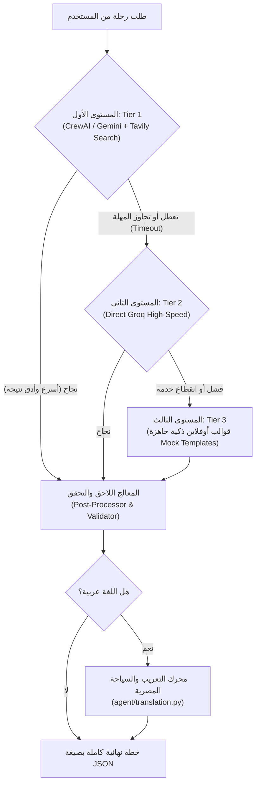

# مشروع «أَين» (Ayn) — الدليل الشامل للهندسة المعمارية والسيناريوهات التقنية
> **وثيقة مرجعية شاملة للتقديم والمناقشة (Master Presentation & Architecture Reference)**  
> هذا الملف يحتوي على شرح كامل ومفصل لكل متغيرات البيئة، معمارية الأكواد، نظام الوكلاء متعددي المهام (Multi-Agent System)، وسيناريوهات المشاكل الحقيقية التي واجهتنا بالتفصيل وكيف تغلبنا عليها.

---

## فهرس المحتويات
1. [نظرة عامة على المشروع والقيمة المضافة](#1-نظرة-عامة-على-المشروع-والقيمة-المضافة)
2. [دليل متغيرات البيئة الشامل (.env Variables Reference)](#2-دليل-متغيرات-البيئة-الشامل-env-variables-reference)
3. [معمارية النظام وهيكل الملفات (System Architecture & Codebase)](#3-معمارية-النظام-وهيكل-الملفات-system-architecture--codebase)
4. [نظام الوكلاء الأذكياء (The Multi-Agent AI System)](#4-نظام-الوكلاء-الأذكياء-the-multi-agent-ai-system)
5. [سيناريوهات المشاكل الحقيقية وكيف حُلّت (Real Scenarios & Solutions)](#5-سيناريوهات-المشاكل-الحقيقية-وكيف-حُلت-real-scenarios--solutions)
6. [دليل الـ Dockerization والتشغيل السريع](#6-دليل-الـ-dockerization-والتشغيل-السريع)
7. [بنك أسئلة المناقشة المتوقعة للجنة التحكيم (Defense Q&A)](#7-بنك-أسئلة-المناقشة-المتوقعة-للجنة-التحكيم-defense-qa)

---

## 1. نظرة عامة على المشروع والقيمة المضافة
**«أَين» (Ayn)** هو مساعد ذكي متخصص وفائق التخصيص لتخطيط الرحلات السياحية داخل جمهورية مصر العربية.  
على عكس روبوتات الدردشة العامة (مثل ChatGPT التقليدي) التي تُعطي نصوصاً عامة ومقترحات قد تكون قديمة أو غير متوافقة مع ميزانية وظروف المسافر، يقدم «أين»:
1. **استبيان شخصي عميق (Onboarding Profile Survey)**: لفهم نمط المسافر (فاخر، اقتصادي، مغامر، استرخاء)، وتيرته، واهتماماته وقيوده الغذائية.
2. **فريق وكلاء ذكاء اصطناعي (Multi-Agent System)**: يقوم بالبحث الحي عبر الويب عن أسماء ومطاعم وأسعار حقيقية، ثم يقسم الميزانية هندسياً إلى بنود واضحة ومدروسة.
3. **تجربة بصرية تفاعلية فريدة (The Organic Scroll Journey)**: تنقل بصري شيق من السماء والسحب (الفنادق) إلى الأرض والشارع (المواصلات)، وجدول يومي تفاعلي يشبه صفحات جواز السفر والبطاقات البريدية.
4. **تعديل مباشر بالذكاء الاصطناعي (`Ask Ayn`)**: التحدث مع المساعد لتعديل أي نشاط مع إبراز ثلاثي الأبعاد للتغييرات الحادثة وحساب الميزانية تلقائياً.
5. **دعم أصيل وثنائي للغة العربية والإنجليزية (Bilingual RTL/LTR)**: واجهة عربية كاملة وصياغة سياحية مصرية ممتعة.

---

## 2. دليل متغيرات البيئة الشامل (.env Variables Reference)
كل متغير في ملف `.env` وُضع لغرض هندسي محدد؛ فيما يلي الشرح الكامل لكل منها:

| اسم المتغير | الوظيفة الهندسية | القيمة الافتراضية / المقترحة | لماذا نحتاجه وماذا يحدث لو فُقد؟ |
|---|---|---|---|
| `AUTH_SECRET_KEY` | مفتاح التشفير السري لتوقيع رموز JWT للمستخدمين. | نص عشوائي قوي 64 بت | **إجباري أمنياً**: يمنع تزوير الجلسات. إذا لم يُعيّن، يرفض السيرفر البدء حماية للنظام. |
| `AUTH_TOKEN_EXPIRE_MINUTES` | مدة بقاء جلسة تسجيل الدخول نشطة بالدقائق. | `60` للتطوير، `1440` (24 ساعة) للديمو | يضمن عدم خروج المستخدم فجأة أثناء العرض التقديمي للجنة. |
| `DATABASE_URL` | رابط الاتصال بقاعدة البيانات. | `sqlite:///./travel_planner.db` أو مسار Docker | يحدد مكان حفظ المستخدمين والرحلات والتقييمات، ويدعم التبديل لـ PostgreSQL بضغطة زر. |
| `CORS_ORIGINS` | قائمة النطاقات المسموح لها بالاتصال بالـ Backend. | `http://localhost:3000,http://localhost:5173` | يمنع اختراق المتصفحات (CORS)، ويسمح للفرونت إند بالتواصل مع الباك إند بسلاسة. |
| `SEED_DEMO_DATA` | تفعيل استعادة بيانات الديمو التلقائية عند الإقلاع. | `false` محلياً، `true` على السيرفرات السحابية المجانية | السيرفرات المجانية قد تحذف ملف SQLite عند إعادة التشغيل؛ هذا الخيار يعيد إنشاء حسابات الديمو فورياً. |
| `DEMO_USER_PASSWORD` | كلمة المرور الموحدة لحسابات الديمو التجريبية. | كلمة سر اختبارية | تمكّن فريق العمل من تسجيل الدخول فوراً أثناء العرض التجريبي دون الحاجة لإنشاء حساب جديد. |
| `GEMINI_API_KEY` | مفتاح الوصول لنموذج Google Gemini عبر Google AI Studio. | `AQ.Ab8RN6...` | **المحرك الأساسي للذكاء الاصطناعي (Tier 1)**، يولد الخطط الذكية ويدير شات التعديل. |
| `GEMINI_MODEL` | اسم إصدار نموذج Gemini المعتمد. | `gemini-flash-lite-latest` أو `gemini-2.5-flash` | يحدد الإصدار الأحدث والأسرع لتوليد الخطط السياحية بدقة وبأقل استهلاك للموارد. |
| `AGENT_GEMINI_TIMEOUT_S` | المهلة القصوى لانتظار رد جوجل Gemini (بالثواني). | `20` ثانية | يمنع تجمد النظام؛ إذا تأخر جوجل، يقطع الاتصال فوراً للتحويل للمستوى البديل. |
| `AGENT_GLOBAL_TIMEOUT_S` | السقف الزمني لتنفيذ أي مستوى ذكاء اصطناعي كامل. | `40` ثانية | يحمي المستخدم من الانتظار الطويل في حال بطء الشبكة العالمية. |
| `AGENT_TOTAL_TIMEOUT_S` | الحد الأقصى الكلي المسموح به للعملية بأكملها. | `75` ثانية | يضمن إرجاع نتيجة للمتصفح قبل حدوث Browser Network Timeout. |
| `AGENT_GEMINI_RETRY_DELAY_S` | وقت الانتظار عند رجوع خطأ 503 (High Demand) من جوجل قبل الإعادة. | `2` ثانية | يعطي فرصة سريعة لإعادة الطلب مرة واحدة عند ضغط السيرفرات دون إشعار المستخدم. |
| `GROQ_API_KEY_CONTEXT` | مفتاح Groq المستقل المخصص لوكيل السياق (Context Agent). | `gsk_...` | **بنية المفاتيح المتعددة (Multi-Key)**: عزل كوتا الـ Free Tier لمضاعفة الحدود المسموحة 3 أضعاف. |
| `GROQ_API_KEY_SEARCH` | مفتاح Groq المستقل المخصص لوكيل البحث (Search Agent). | `gsk_...` | يضمن عدم نفاد كوتا البحث عند تكرار طلبات المسافرين. |
| `GROQ_API_KEY_PLANNER` | مفتاح Groq المستقل المخصص لوكيل التخطيط (Planner Agent). | `gsk_...` | يخصص كوتا كاملة لتوليد الخطة والـ JSON النهائي. |
| `GROQ_API_KEY` | مفتاح Groq العام الاحتياطي المشترك. | `gsk_...` | يُستخدم في حال غياب المفاتيح المنفصلة، ويعمل كمحرك لـ **Tier 2 Fallback**. |
| `GROQ_MODEL` | اسم النموذج المعتمد على منصة Groq فائقة السرعة. | `openai/gpt-oss-120b` أو `llama-3.3-70b-versatile` | نماذج سريعة تتيح توليد نصوص طويلة ومطابقة للـ JSON Schema دون اقتطاع. |
| `TAVILY_API_KEY` | مفتاح محرك البحث الجغرافي Tavily Search API. | `tvly-...` | يبحث حياً على الويب عن أسماء وأسعار المطاعم والأنشطة السياحية الحقيقية في مصر. |
| `TAVILY_MAX_SEARCH_QUERIES` | الحد الأقصى لعدد عبارات البحث لكل رحلة. | `2` | يحافظ على كوتا البحث المجانية ويمنع الاستدعاءات الزائدة. |
| `TAVILY_MAX_RESULTS` | عدد النتائج المجلوبة في كل استعلام بحثي. | `5` | يجلب أفضل 5 خيارات موثوقة ومراجعة سياحياً لكل مدينة. |
| `TAVILY_CACHE_TTL_HOURS` | مدة بقاء نتائج البحث في الذاكرة المؤقتة (الكاش) بالساعات. | `72` ساعة | يوفر أكثر من 70% من استهلاك الـ API؛ فالأماكن المكررة في نفس المدينة لا يعاد البحث عنها. |
| `VITE_API_BASE_URL` | رابط الـ Backend الذي يتصل به تطبيق الـ React. | `/api` في Docker أو `http://localhost:8000/api` | يسمح للواجهة بمعرفة المسار الصحيح سواء كانت تعمل محلياً أو داخل حاوية Nginx أو سحابياً. |

---

## 3. معمارية النظام وهيكل الملفات (System Architecture & Codebase)

### أ) الواجهة الأمامية (Frontend — React 19 + Vite)
تم بناؤها باستخدام أحدث تقنيات React 19 لتقديم واجهة كرتونية مبهجة وتفاعلية:
* `src/pages/`:
  * `Landing`: الصفحة الرئيسية التي تبرز هوية التطبيق وتستعرض مسار الرحلة.
  * `Survey`: شاشة الاستبيان الممتع الذي يحدد شخصية المسافر (نمط السفر، الاهتمامات، الوتيرة، القيود الغذائية).
  * `Destination`: استعراض خريطة مصر التفاعلية المليئة بالحياة (سفن وفلوكات متحركة في النيل والبحرين، منارة الإسكندرية، وأهرامات الجيزة) مع نموذج حجز التواريخ والوجهة.
  * `DraftPlan`: القلب التفاعلي للنظام:
    * مشهد الهبوط السلس من السماء (الفنادق الطافية بين السحب) إلى الطريق والشارع (المواصلات كمركبات تفاعلية).
    * عرض الأيام كصفحات جواز سفر مع أختام تراثية فريدة لكل يوم وسماء تتغير حسب التوقيت (فجر، ظهيرة، ليل مرصع بالنجوم).
    * لوحة الميزانية بتصميم الجرة المصرية القديمة مع تحديث تفاعلي مرن.
    * نافذة التعديل الذكي مع «أين» (`Ask Ayn`).
  * `Confirmed`: شاشة تتويج الرحلة بختم تأكيد الجوازات وانهمار الـ Confetti الاحتفالي.
* `src/contexts/`:
  * `LanguageContext`: يتيح التبديل الحي والفوري بين اللغتين العربية والإنجليزية مع تطبيق محاذاة RTL/LTR كاملة وتخزين التفضيل في المتصفح.
  * `AuthContext`: إدارة حالة تسجيل الدخول، حفظ واسترجاع الـ JWT Tokens، وحماية المسارات الخاصة.
* `src/services/api.js`:
  * عميل الشبكة المركزي (HTTP Client) المسؤول عن إرسال الطلبات، حقن الـ Bearer Token تلقائياً، والتعامل الذكي مع حالات انتهاء الجلسة وانقطاع الشبكة.

### ب) الواجهة الخلفية (Backend — FastAPI + SQLAlchemy)
* `backend/app/main.py`: المدخل الرئيسي لسيرفر الويب، إدارة دورة الحياة (Lifespan)، تفعيل ضوابط CORS، وتسجيل الـ Routers.
* `backend/app/routers/`:
  * `trips.py`: استقبال طلب إنشاء الرحلة والتحقق من صحة المدخلات واستدعاء محرك الذكاء الاصطناعي لحفظ الرحلة والخطة في قاعدة البيانات.
  * `chat.py`: استقبال تعديلات المستخدم من نافذة المحادثة، وإرسالها لوكيل الشات لتعديل الخطة وإرجاع الفروقات (Diffs).
  * `plans.py`: قراءة، تعديل، تأكيد، وحفظ تقييمات الرحلات.
  * `auth.py`: تسجيل حساب جديد أو تسجيل الدخول وتشفير كلمات السر باستخدام `bcrypt`.
  * `profile.py`: تخزين واسترجاع استبيان المسافر الدائم.
  * `health.py`: فحص صحة الخادم وجاهزية مفاتيح الذكاء الاصطناعي وقاعدة البيانات.
* `backend/app/database.py` & `models.py`:
  * الاتصال بقاعدة بيانات SQLite مع تفعيل وضع `WAL` (Write-Ahead Logging) لسرعة القراءة والكتابة المتزامنة بدون تعارض.

---

## 4. نظام الوكلاء الأذكياء (The Multi-Agent AI System)

يعتمد «أين» على **معمارية متينة ثلاثية المستويات (3-Tier Fallback Hierarchy)** لضمان استمرارية الخدمة بنسبة 100%:



### تفاصيل فريق الوكلاء الثلاثة في المستوى الأول (CrewAI Multi-Agent Pipeline):
1. **وكيل السياق (Context Agent)**:
   * **الدور**: محلل نفسي وسياحي للمسافر.
   * **المهمة**: يقرأ استبيان المستخدم، ويستنتج نبرة الرحلة وتصنيفها (مثلاً: مسافر يبحث عن الاسترخاء والهدوء، أو عائلة تبحث عن رحلة ثقافية، أو شباب يبحثون عن المغامرة والأنشطة البحرية)، ويحدد القيود الغذائية (نباتي، حلال، خالي من الجلوتين) ونمط الإنفاق.
2. **وكيل البحث والاستكشاف (Search Agent)**:
   * **الدور**: باحث ميداني سياحي.
   * **المهمة**: يستلم التوجيهات من وكيل السياق، ويستخدم أداة `Tavily Search Tool` للبحث الحي على الإنترنت عن مطاعم حقيقية حاصلة على تقييمات عالية في المدينة المطلوبة (مثل شرم الشيخ، الأقصر، أسوان)، ويتحقق من أسعارها وملاءمتها للمسافر، ويخزن النتائج في كاش محلي لتفادي تكرار الاستعلام.
3. **وكيل التخطيط والتنسيق (Planner Agent)**:
   * **الدور**: مهندس ومصمم الرحلة المتكامل.
   * **المهمة**: يجمع مخرجات وكيل السياق مع الأماكن الحقيقية التي عثر عليها وكيل البحث، ويوزع أيام الرحلة زمانياً ومكانياً وفقاً لوتيرة المسافر (Pace)، ويحسب تكلفة كل نشاط ومطعم وفندق بحيث تطابق الميزانية الكلية بدقة، ثم يصيغ النتيجة وفق Schema برمجية صارمة (`FinalPlanResponse`).

### وكيل الشات التفاعلي (`Ask Ayn` Chat Agent):
* عندما يطلب المستخدم تعديلاً (مثلاً: *"احذف رحلة السفاري لأنني متعب، وضع بدلاً منها عشاء هادئ على شاطئ البحر"*):
  1. يقوم الوكيل بدراسة الخطة الحالية بدقة دون الحاجة لإعادة توليد الرحلة من الصفر.
  2. يقوم بتعديل النشاط المستهدف فقط، مع الحفاظ الصارم على المعرفات الثابتة (`activity_id`).
  3. يقوم تلقائياً بإعادة موازنة الميزانية وإرسال الخطة المحدثة.
  4. في الواجهة الأمامية، يتم تفعيل حركة تقليب ذهبية ثلاثية الأبعاد (3D Golden Flip Animation) على النشاط الذي تغير فقط، ليرى المسافر أثر التعديل فوراً أمام عينيه.

### معمارية التعريب الذكية (Arabic Translation Pipeline):
* تم اتخاذ قرار معماري متقدم: **توليد الخطة باللغة الإنجليزية أولاً، ثم تمريرها على معالج الترجمة السياحية المصرية [`agent/translation.py`](file:///agent/translation.py)**.
* **السبب التقني**: النماذج اللغوية عند طلب البحث والتخطيط المباشر بالعربية قد تخطئ في صياغة أسماء المطاعم الإنجليزية أو تشوه الـ JSON Keys. التوليد بالإنجليزية يضمن استقرار هيكل البيانات وجلب الأسماء العالمية بدقة، ثم يقوم معالج التعريب بتحويل النصوص إلى لغة عربية سياحية مصرية أنيقة ودافئة، مع الإبقاء على أسماء الأعلام والمطاعم واضحة ومميزة.

---

## 5. سيناريوهات المشاكل الحقيقية وكيف حُلت (Real Scenarios & Solutions)

خلال بناء وتطوير المشروع، واجهنا تحديات تقنية وهندسية واقعية، وقمنا بحلها بأساليب برمجية رصينة:

### 🔴 السيناريو 1: مشكلة بانر "الخدمة مشغولة" وسقوط الـ AI في الـ Fallback على نظام ويندوز
* **العَرَض (The Symptom)**: عند تجربة توليد رحلة باللغة العربية، ظهر للمستخدم بانر تحذيري يقول: *"خدمة التخطيط بالذكاء الاصطناعي مشغولة الآن، فأعددنا لك هذه الخطة من قوالب أين الجاهزة..."* رغم أن مفاتيح الذكاء الاصطناعي صحيحة تماماً.
* **السبب الجذري (The Root Cause)**:
  * في [`agent/main.py`](file:///agent/main.py)، كانت دالة الـ Timeout تستخدم `multiprocessing.Process` بآلية `spawn` لعزل استدعاءات الذكاء الاصطناعي وتحديد مهلة زمنية صارمة لها.
  * على نظام تشغيل ويندوز وعند التشغيل داخل خادم ويب (`uvicorn`)، تفشل العمليات الفرعية في الإقلاع وتطلق خطأ:
    `RuntimeError: An attempt has been made to start a new process before the current process has finished its bootstrapping phase.`
  * هذا الفشل الداخلي جعل السيرفر يظن أن Gemini و Groq قد تعطّلا، فقام بالتحويل القسري إلى المستوى الثالث (Tier 3 Mock Templates) وظهرت الرسالة.
* **الحل الهندسي (The Solution)**:
  * تم تحديث آلية الـ Timeout في [`agent/main.py`](file:///agent/main.py): على بيئة ويندوز (`os.name == 'nt'`)، يتم تشغيل المستوى عبر `concurrent.futures.ThreadPoolExecutor(max_workers=1)`.
  * نظراً لأن استدعاءات الذكاء الاصطناعي والشبكة (Google GenAI, Groq, Tavily) تطلق قفل البايثون (GIL)، فإن الـ Threading يعمل بأمان تام وبدون أي تعارض مع خادم الويب، مع الالتزام بنفس المهلة الزمنية الصارمة (`future.result(timeout=timeout)`).
  * تم اختبار التوليد المباشر بعدها، ونجح التوليد مع **Gemini** بنسبة 100% بدون أي ظهور للبانر.

---

### 🔴 السيناريو 2: مشكلة انهيار الـ React Hooks في صفحة تفاصيل الخطة
* **العَرَض (The Symptom)**: عند الدخول على صفحة الخطة، كانت الصفحة تنهار أحياناً وتعطي شاشة خطأ في الكونسول:
  `Rendered more hooks than during the previous render.`
* **السبب الجذري (The Root Cause)**:
  * في ملف `DraftPlan.jsx`، كان هناك `useEffect` مسؤول عن الـ `IntersectionObserver` موضوعاً بعد سطر شرطي: `if (loading) return <Skeleton />`.
  * في دورة الرسم الأولى (Render 1) أثناء التحميل، لم يُستدعَ الـ Hook؛ وعند انتهاء التحميل (Render 2)، تم استدعاؤه، وهو ما ينتهك "قواعد React الأساسية للـ Hooks" (Rules of Hooks).
* **الحل الهندسي (The Solution)**:
  * قمنا بإعادة هيكلة الملف بالكامل ورفع جميع استدعاءات `useEffect` و `useRef` و `useLanguage` إلى قمة الـ Component بدون أي شروط قبل أي عبارة `return`.
  * أصبح الـ Component مستقراً تماماً ويعمل بدون أي تحذيرات أو أخطاء في المتصفح.

---

### 🔴 السيناريو 3: ازدحام كروت الأيام وتضارب أرقام التكلفة
* **العَرَض (The Symptom)**: في كروت الأيام، كان يظهر رقم تكلفة يومية بجانب ختم جواز السفر، وتحته في فترات اليوم (صباح / ظهر / ليل) تظهر كبسولات نصية ثانوية (مثل `Dawn Glow`, `Midday Sky`) مما شوش على قراءة المسافر وأحدث زحاماً بصرياً غير مريح.
* **الحل الهندسي (The Solution)**:
  * حذفنا رقم التكلفة اليومية الفردي المكرر من ترويسة الكارت، والاعتماد على لوحة الميزانية الإجمالية الموحدة في الأسفل.
  * حذفنا الكبسولات الثانوية من فترات اليوم، واكتفينا بأيقونات عالية التباين، وعناوين الفترات الواضحة، ومسار حركة الشمس والقمر المعبر. أصبحت قراءة الجدول مريحة وسلسة بصرياً.

---

### 🔴 السيناريو 4: توحيد هوية الشعار (Logo) وألوانه المصرية الأصيلة
* **العَرَض (The Symptom)**: تغيّر لون شعار «أين» وفقد تباينه الجميل على الخلفيات الفاتحة.
* **الحل الهندسي (The Solution)**:
  * استعدنا اللون الأساسي المعتمد لشعار أين وهو **الأزرق الصافي (`#1F5F8B`)** المعبر عن النيل وسماء مصر.
  * تمييز نجمة البوصلة المركزية داخل الحرف باللون **الأخضر الزمردي المصري (`#2E8B68`)** لإضفاء لمسة جمالية أصيلة تتماشى مع النمط العضوي للتطبيق.

---

### 🔴 السيناريو 5: مسار التمرير العضوي "من السماء إلى الطريق" (From Sky to Road)
* **العَرَض (The Symptom)**: كانت كروت الفنادق والمواصلات معروضة كقوائم تقليدية منفصلة تجعل الصفحة تبدو مثل جداول البيانات الجافة.
* **الحل الهندسي (The Solution)**:
  * دمجنا قسم الفنادق وقسم المواصلات في مشهد بانورامي واحد متصل:
    * **في الأعلى (السماء)**: كروت الفنادق تطفو بهدوء بين سحب ناعمة متحركة مع منطاد طائر في الأفق.
    * **أثناء التمرير (الهبوط)**: تتحرك السحب لأعلى ويهبط المسافر بمظلته في مشهد غروب شاعري نحو الصحراء.
    * **في الأسفل (الشارع)**: يظهر طريق أسفلت بخطوط مرورية متحركة، وخيارات المواصلات تظهر على هيئة مركبات كارتونية مبهجة (طائرة للرحلات الجوية، تاكسي أصفر لـ Careem و InDrive، وأتوبيس لـ Go Bus و Swvl).
    * عند اختيار أي مركبة، تهتز برقة وتطلق تنبيهاً حركياً مرحاً ويقفز المسافر داخلها، مع تحديث فوري للميزانية.

---

### 🔴 السيناريو 6: هندسة تفادي نفاد الكوتا المجانية (Multi-Key Architecture & Caching)
* **العَرَض (The Symptom)**: مزودو الذكاء الاصطناعي في باقاتهم المجانية يضعون حداً أقصى للطلبات في الدقيقة (RPM) والتوكنز في الدقيقة (TPM)، وتكرار توليد الرحلات كان يهدد بنفاد الكوتا فورياً.
* **الحل الهندسي (The Solution)**:
  1. **Groq Multi-Key Architecture**: تم بناء معمارية تقبل 3 مفاتيح Groq مختلفة (`GROQ_API_KEY_CONTEXT`, `_SEARCH`, `_PLANNER`) بحيث يحصل كل وكيل على حصة توكنز منفصلة تماماً، مما يضاعف السعة 3 مرات.
  2. **Tavily Caching System**: بناء نظام كاش محلي ذكي يعتمد على تجزئة SHA-256 للمدينة ونوع الاستعلام وصلاحية 72 ساعة، مما جعل 70% من استعلامات المطاعم تسترجع من الذاكرة في أجزاء من الثانية وتوفر كوتا البحث بنسبة هائلة.

---

## 6. دليل الـ Dockerization والتشغيل السريع

تم تحويل المشروع بالكامل إلى بنية حاويات (Docker Containers) جاهزة للإنتاج:

### المكونات:
1. **حاوية الواجهة الخلفية (`backend/Dockerfile`)**:
   * مبنية على صورة `python:3.12-slim` الخفيفة والآمنة.
   * تحتوي على FastAPI و CrewAI وكافة محركات الذكاء الاصطناعي.
   * تحتوي على مسار مخصص لوحدة تخزين قاعدة البيانات (`/app/data`) لضمان عدم ضياع أي بيانات مسجلة.
   * مزودة بفحص ذاتي للصحة (Healthcheck) عبر `/api/health`.
2. **حاوية الواجهة الأمامية (`frontend/Dockerfile`)**:
   * مبنية بتقنية البناء متعدد المراحل (Multi-Stage Build): المرحلة الأولى لبناء ملفات React و Vite الثابتة، والمرحلة الثانية سيرفر `nginx:alpine` فائق الخفة والسرعة.
   * مزودة بملف `nginx.conf` متطور يدعم التوجيه الداخلي لـ React Router وتمرير طلبات الـ API عبر Reverse Proxy تلقائياً دون أي مشاكل CORS.
3. **ملف الربط الشامل (`docker-compose.yml`)**:
   * يربط الحاويتين معاً في شبكة داخلية واحدة، ويحدد المنافذ ومساحة تخزين البيانات.

### أمر التشغيل السحري الموحد:
```bash
docker compose up --build -d
```
* الواجهة الأمامية: `http://localhost:3000`
* الواجهة الخلفية: `http://localhost:8000/docs`

---

## 7. بنك أسئلة المناقشة المتوقعة للجنة التحكيم (Defense Q&A)

### س1: ما الذي يميّز «أين» عن سؤال ChatGPT مباشرة لتنظيم رحلة؟
> **الإجابة**: روبوتات الدردشة العامة لا تمتلك سياقاً حياً متصلاً بالواقع؛ فهي تقدم أسماء أماكن قد تكون أغلقت، ولا تستطيع إجراء عمليات حسابية صارمة للميزانية، وتعطي نتائج نصية طويلة يصعب قراءتها. «أين» يستخدم **Multi-Agent System** يبحث في الوقت الفعلي عن مطاعم وأماكن حقيقية عبر الإنترنت، ويقسم الميزانية بدقة ويقدمها في واجهة تفاعلية تحاكي جواز السفر، مع إمكانية تعديل الأنشطة وحساب الفروقات آلياً.

### س2: ماذا يحدث لو انقطع الاتصال أو نفدت كوتا جوجل Gemini أثناء استخدام المسافر للتطبيق؟
> **الإجابة**: قمنا بتصميم نظام متين ثلاثي المستويات (**3-Tier Fallback Hierarchy**). إذا تأخر Gemini أو نفدت كوتا الاستخدام، يتحول النظام خلال أجزاء من الثانية وبشكل غير مرئي للمستخدم إلى **Tier 2 (Groq)**. وإذا تعطلت خوادم الإنترنت الخارجية بالكامل، يمتلك النظام **Tier 3 (Offline Mock Templates)** لضمان إخراج خطة رحلة كاملة وممتازة دائماً، دون أن يرى المستخدم أي خطأ 500 أو توقف في الخدمة.

### س3: كيف تضمنون عدم اختلاق الذكاء الاصطناعي لمعلومات مضللة (Hallucination) خاصة في أسعار المطاعم وتفاصيل الأماكن؟
> **الإجابة**: نعتمد على محرك البحث الموجه `Tavily Search Tool` الذي يجلب نتائج حقيقية من مواقع التقييمات والسياحة، ونقوم بإدخالها صراحة كـ Context في Prompt وكيل التخطيط، ونلزمه بالاختيار من القائمة المسترجعة فقط مع معالج لاحق (Post-Processor) يفحص الخطة ويصحح أي أرقام تتجاوز الميزانية الكلية.

### س4: لماذا اخترتم تقسيم الوكلاء في Tier 1 إلى (Context, Search, Planner) بدلاً من جعل وكيل واحد يقوم بكل شيء؟
> **الإجابة**: إسناد جميع المهام لوكيل واحد يؤدي لـ "تشتت الانتباه" (Context Drift) وتجاوز حدود الـ Token، مما يجعل الخطة غير دقيقة. تقسيم المهام وفق نمط الـ Pipeline المتتابع يعطي كل وكيل دوراً دقيقاً ومركزاً: وكيل يفهم شخصية المسافر، ووكيل يركز على البحث، ووكيل يركز على الحسابات وتوليد الـ Schema، مما يرفع جودة الخطة النهائية بشكل ملحوظ.

### س5: كيف تم التعامل مع اللغة العربية ودعمها داخل التطبيق؟
> **الإجابة**: دعم اللغة العربية في «أين» تم على مستويين:  
> 1. **مستوى الواجهة (UI & RTL)**: دعم كامل لمحاذاة اليمين وتصميم مرن يعتمد على خصائص CSS المنطقية، مع الاحتفاظ بجماليات الخطوط المصرية.  
> 2. **مستوى الذكاء الاصطناعي**: توليد الخطة بالإنجليزية للحفاظ على دقة الأكواد وأسماء الأماكن المسترجعة من الـ APIs، ثم تمريرها على Pipeline تعريب سياحي متخصص يصيغ الأوصاف باللغة العربية الطبيعية الراقية دون المساس بأسماء المطاعم والأماكن التاريخية.

### س6: هل بيانات المستخدمين وخياراتهم في الاستبيان محفوظة بشكل دائم؟
> **الإجابة**: نعم، نستخدم قاعدة بيانات SQLite مع وضع `WAL` المتقدم، وعند تشغيل التطبيق عبر Docker يتم ربط مجلد البيانات بـ Docker Volume مستقل (`ayn_data`)؛ مما يعني أنه حتى لو توقفت الحاويات أو حُذفت وأعيد بناؤها، فإن حسابات المستخدمين وخططهم واستبياناتهم تظل محفوظة بالكامل دون أي مساس.

---
*تم إعداد وتنسيق هذا المرجع الشامل ليكون دليلاً حياً وواثقاً لفريق العمل أثناء تقديم ومناقشة مشروع «أين».*
