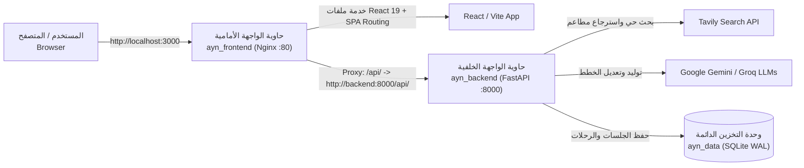

# 🐳 دليل تشغيل ونشر مشروع «أين» عبر Docker
> **Ayn Travel Planner — Production Dockerization & Deployment Guide**

يوفر هذا الدليل كل ما تحتاجه لتشغيل ونشر مشروع «أين» بالكامل (Frontend + Backend + Multi-Agent Engine + Database) باستخدام **Docker** و **Docker Compose** في أقل من 60 ثانية وبأمر واحد فقط.

---

## 🏗️ معمارية الحاويات (Container Architecture)



---

## ⚡ التشغيل السريع في 60 ثانية (Quick Start)

### 1. المتطلبات الأساسية
* تثبيت **[Docker Desktop](https://www.docker.com/products/docker-desktop/)** (أو Docker Engine على أنظمة Linux).
* التأكد من تشغيل تطبيق Docker Desktop على جهازك.

### 2. إعداد مفاتيح البيئة
انسخ ملف `.env.example` إلى `.env` (إذا لم تكن قد أنشأته بعد):
```bash
cp .env.example .env
```
تأكد من وجود مفتاح سري للتشفير (أو اتركه لتوليده تلقائياً):
```bash
# توليد مفتاح تشفير أمني سريع
python -c "import secrets; print(secrets.token_hex(32))"
```
*(ملاحظة: يمكنك تجربة المشروع بدون أي مفاتيح ذكاء اصطناعي وسيعمل بنظام القوالب الذكية الاحتياطية Tier 3، ولكن لإخراج خطط حقيقية أضف مفتاح `GEMINI_API_KEY` و `TAVILY_API_KEY` في ملف `.env`).*

### 3. إطلاق المشروع بأمر واحد
قم بتنفيذ الأمر التالي في المجلد الرئيسي للمشروع:
```bash
docker compose up --build -d
```

### 4. الروابط المباشرة
بمجرد انتهاء البناء، يمكنك فتح الروابط التالية فوراً:
* 🌐 **تطبيق الويب (Frontend)**: [http://localhost:3000](http://localhost:3000)
* 📡 **واجهة توثيق الـ API (FastAPI Swagger)**: [http://localhost:8000/docs](http://localhost:8000/docs)
* 🩺 **فحص صحة النظام (Health Check)**: [http://localhost:8000/api/health](http://localhost:8000/api/health)

---

## 📋 أوامر الإدارة اليومية (Useful Docker Commands)

### عرض حالة الحاويات
```bash
docker compose ps
```

### متابعة السجلات المباشرة (Live Logs)
```bash
# متابعة سجلات النظام بالكامل
docker compose logs -f

# متابعة سجلات الباك إند والذكاء الاصطناعي فقط
docker compose logs -f backend

# متابعة سجلات الفرونت إند وسيرفر Nginx فقط
docker compose logs -f frontend
```

### إعادة تشغيل الحاويات
```bash
docker compose restart
```

### إيقاف التشغيل
```bash
# إيقاف الحاويات مع الحفاظ على قاعدة البيانات والمستخدمين
docker compose down

# إيقاف الحاويات وحذف الـ Volumes (تصفير قاعدة البيانات والبدء من الصفر)
docker compose down -v
```

### إعادة البناء عند تعديل الأكواد
```bash
docker compose up --build -d
```

---

## 💾 استمرارية البيانات (Data Persistence)

* يتم حفظ قاعدة البيانات `travel_planner.db` وسجلات الرحلات وحسابات المستخدمين داخل Docker Volume مخصص باسم **`ayn_data`**.
* هذا المجلد مربوط بمسار `/app/data` داخل حاوية الباك إند.
* **النتيجة**: لن تفقد بيانات المستخدمين أو استبياناتهم أو رحلاتهم المؤكدة أبداً حتى لو قمت بإعادة تشغيل الحاوية أو تحديث الكود.

---

## 🚀 النشر على السيرفرات السحابية (Cloud Deployment)

### أ) النشر على Render أو Railway (موصى به للعرض)
1. **الواجهة الخلفية (Backend)**:
   * اختر **New Web Service** واربط مستودع الـ GitHub.
   * اختر مسار الـ `Dockerfile`: حدد `backend/Dockerfile` والـ Build Context هو المجلد الرئيسي `.`.
   * أضف الـ Environment Variables من ملف `.env` (خصوصاً `AUTH_SECRET_KEY` و `GEMINI_API_KEY` و `TAVILY_API_KEY`).
   * اضبط المنفذ على `8000`.
2. **الواجهة الأمامية (Frontend)**:
   * يمكن رفعها كـ Static Site على **Vercel** مجاناً مع ضبط `VITE_API_BASE_URL` إلى رابط الباك إند على Render (`https://your-backend.onrender.com/api`).
   * أو رفعها كـ Web Service باستخدام `frontend/Dockerfile`.

### ب) النشر على خادم خاص (VPS / Ubuntu Server)
1. قم بتثبيت Docker و Docker Compose على الخادم:
   ```bash
   sudo apt-get update
   sudo apt-get install -y docker.io docker-compose-plugin
   ```
2. استنسخ المشروع وضع ملف الـ `.env`:
   ```bash
   git clone <REPO_URL>
   cd Personal-travel-planner-Agent
   nano .env
   ```
3. أطلق المشروع:
   ```bash
   docker compose up --build -d
   ```
4. المشروع سيعمل فوراً ومتاح عبر الـ IP الخاص بسيرفرك على المنفذ `3000`.

---

## 🔍 استكشاف الأخطاء الشائعة (Troubleshooting)

1. **الخطأ: `docker: command not found` أو عدم استجابة الـ Daemon**:
   * تأكد من أن تطبيق **Docker Desktop** مفتوح وقيد التشغيل في شريط المهام بجهازك.
2. **المنفذ 3000 أو 8000 مشغول بالفعل**:
   * يمكنك تغيير المنفذ الخارجي في ملف `docker-compose.yml` (مثلاً: `"3001:80"` أو `"8080:8000"`).
3. **تغييرات الكود لا تنعكس**:
   * استخدم علم `--build` دائماً عند تعديل الأكواد لإعادة بناء الصور: `docker compose up --build -d`.
