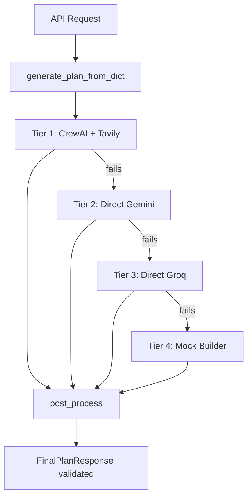

# 🚀 Sprint 3 — Abdelrhman Esma3el: Full Incremental Plan

> **Today:** 15 Oct 2026, 14:30 — Day 3 of Sprint 3 (13–19 Oct)  
> **Demo:** Tuesday 20 Oct 2026  
> **Strategy:** One task at a time, verified before moving on. Each task has a clear rollback path.

---

## 🗺️ Architecture Overview (Current State)



**Key files already in place:**
| File | Role |
|---|---|
| [`agent/main.py`](file:///e:/depi%205/mini_project1/Personal-travel-planner-Agent/agent/main.py) | 3-tier orchestrator |
| [`agent/schemas.py`](file:///e:/depi 5/mini_project1/Personal-travel-planner-Agent/agent/schemas.py) | Pydantic models (FinalPlanResponse, UserProfile, TripRequest) |
| [`agent/fallbacks/direct_gemini.py`](file:///e:/depi%205/mini_project1/Personal-travel-planner-Agent/agent/fallbacks/direct_gemini.py) | Direct Gemini (15 s timeout already set) |
| [`agent/fallbacks/direct_groq.py`](file:///e:/depi%205/mini_project1/Personal-travel-planner-Agent/agent/fallbacks/direct_groq.py) | Direct Groq (25 s timeout already set) |
| [`agent/fallbacks/mock_builder.py`](file:///e:/depi%205/mini_project1/Personal-travel-planner-Agent/agent/fallbacks/mock_builder.py) | Deterministic mock (never fails) |
| [`agent/validators/post_processor.py`](file:///e:/depi%205/mini_project1/Personal-travel-planner-Agent/agent/validators/post_processor.py) | Budget repair + ID assignment |
| [`tests/validate_output.py`](file:///e:/depi%205/mini_project1/Personal-travel-planner-Agent/tests/validate_output.py) | ✅ Already exists — needs A5 additions |
| [`agent/tools/tavily_tool.py`](file:///e:/depi%205/mini_project1/Personal-travel-planner-Agent/agent/tools/tavily_tool.py) | Tavily search (capped at 2 queries) |

---

## 📦 Task 1 — Package List & `.env.example` (A3)
**Due: 15 Oct Evening | Effort: S | Unblocks: El Yamny Y1**

### What's needed
- Pin all packages in `requirements.txt` with working versions.
- Fix `GEMINI_MODEL` in `.env.example` and add deprecation comment.
- Add `google-genai` and `json_repair` (currently missing from `requirements.txt`).
- **Add AgentOps** for A1 monitoring (optional key — graceful import).

### Files changed

#### [MODIFY] `requirements.txt`
```diff
-crewai>=0.80.0
-groq>=0.11.0
-tavily-python>=0.5.0
-pydantic>=2.7.0
-python-dotenv>=1.0.0
-litellm>=1.40.0
+crewai>=0.80.0
+groq>=0.11.0
+tavily-python>=0.5.0
+pydantic>=2.7.0
+python-dotenv>=1.0.0
+litellm>=1.40.0
+google-genai>=0.8.0
+json_repair>=0.28.0
+agentops>=0.3.0
```

#### [MODIFY] `.env.example`
```diff
-GEMINI_MODEL=gemini-1.5-flash
+# ⚠️  The old name "gemini-1.5-flash" is DEPRECATED — use the value below.
+GEMINI_MODEL=gemini-flash-lite-latest
+
+# AgentOps (optional — only needed for A1 performance dashboard)
+# Get a free key at: https://app.agentops.ai/
+AGENTOPS_API_KEY=
```

### Verification
```powershell
# In a fresh venv
python -m venv venv_clean
.\venv_clean\Scripts\activate
pip install -r requirements.txt
python -c "import crewai, groq, tavily, google.genai, json_repair, pydantic, dotenv, agentops; print('All OK')"
```
**Done when:** clean import prints `All OK`.

---

## 📊 Task 2 — Agent Performance Measurements (A1)
**Due: 16 Oct 10:00 | Effort: M | Drives: Manal M5**

### Approach — Two layers
| Layer | Tool | Purpose |
|---|---|---|
| **AgentOps** | `agentops` library | Session-level tracing, token count, cost (when key is set) |
| **Local CSV/MD logger** | `time`, `json` | Always-on, no external dependency |

> [!NOTE]
> AgentOps wraps the whole session with `agentops.init()` + `@agentops.track_agent`. If no API key is set, it degrades gracefully. The local logger always writes to `docs/agent_measurements.md`.

### New files

#### [NEW] `agent/monitoring.py`
Central monitoring module used by all tiers.

```python
"""Lightweight performance monitor for all agent tiers.

Usage:
    from agent.monitoring import MonitorContext
    with MonitorContext("gemini", profile, trip) as ctx:
        result = run_direct_gemini_fallback(...)
        ctx.set_valid(True)   # set after JSON validation
    # ctx.record is written to docs/agent_measurements.md
"""
import os, time, json, logging
from contextlib import contextmanager
from dataclasses import dataclass, field, asdict
from pathlib import Path
from datetime import datetime

logger = logging.getLogger("agent.monitoring")

# Optional AgentOps
try:
    import agentops
    _AO_KEY = os.getenv("AGENTOPS_API_KEY", "")
    if _AO_KEY:
        agentops.init(_AO_KEY, skip_auto_end_session=True)
        AGENTOPS_ENABLED = True
    else:
        AGENTOPS_ENABLED = False
except ImportError:
    AGENTOPS_ENABLED = False

MEASUREMENTS_FILE = Path(__file__).resolve().parent.parent / "docs" / "agent_measurements.md"
_records: list[dict] = []

@dataclass
class RunRecord:
    run_id: str
    tier: str          # "crewai" | "gemini" | "groq" | "mock"
    profile_type: str  # "calm" | "adventurous" | "custom"
    duration_s: float = 0.0
    llm_calls: int = 0
    json_valid: bool = False
    error: str = ""
    timestamp: str = field(default_factory=lambda: datetime.utcnow().isoformat())

@contextmanager
def MonitorContext(tier: str, profile: dict, run_id: str = ""):
    """Context manager that times a tier run and records the result."""
    profile_type = _classify_profile(profile)
    record = RunRecord(
        run_id=run_id or f"{tier}_{int(time.time())}",
        tier=tier,
        profile_type=profile_type,
    )
    ao_session = None
    if AGENTOPS_ENABLED:
        ao_session = agentops.start_session(tags=[tier, profile_type])

    start = time.perf_counter()
    try:
        yield record
    except Exception as exc:
        record.error = str(exc)[:200]
        raise
    finally:
        record.duration_s = round(time.perf_counter() - start, 2)
        _records.append(asdict(record))
        logger.info("[MONITOR] %s | %s | %.1fs | valid=%s | err=%s",
                    tier, profile_type, record.duration_s, record.json_valid, bool(record.error))
        if ao_session:
            ao_session.end_session("Success" if record.json_valid else "Fail")

def _classify_profile(profile: dict) -> str:
    personalities = profile.get("personality", [])
    if "calm" in personalities:
        return "calm"
    if "adventurous" in personalities:
        return "adventurous"
    return "custom"

def flush_to_markdown() -> None:
    """Write all collected records as a Markdown table to docs/agent_measurements.md."""
    if not _records:
        return
    lines = [
        "# Agent Performance Measurements\n",
        "| run_id | tier | profile | duration_s | json_valid | error |",
        "|--------|------|---------|-----------|------------|-------|",
    ]
    for r in _records:
        lines.append(
            f"| {r['run_id']} | {r['tier']} | {r['profile_type']} "
            f"| {r['duration_s']} | {r['json_valid']} | {r['error'] or '—'} |"
        )
    lines.append("\n## Recommendation\n_Fill after reviewing the table._\n")
    MEASUREMENTS_FILE.write_text("\n".join(lines), encoding="utf-8")
    logger.info("Measurements flushed to %s", MEASUREMENTS_FILE)
```

#### [NEW] `scripts/measure_agent.py`
Standalone measurement script — runs 12+ timed runs, saves table, and prints summary.

```python
"""Run 3 × (calm + adventurous) × (crewai | gemini | groq | mock) = 12+ runs.

Usage:
    python scripts/measure_agent.py            # all tiers, both profiles
    python scripts/measure_agent.py --tier mock  # only mock tier
    python scripts/measure_agent.py --skip-crewai  # skip slow Tier 1
"""
import argparse, json, sys
from pathlib import Path
sys.path.insert(0, str(Path(__file__).resolve().parent.parent))

from dotenv import load_dotenv
load_dotenv()

from agent.monitoring import MonitorContext, flush_to_markdown
from agent.fallbacks.direct_gemini import run_direct_gemini_fallback
from agent.fallbacks.direct_groq import run_direct_groq_fallback
from agent.fallbacks.mock_builder import build_mock_plan
from agent.validators.post_processor import post_process
from agent.schemas import FinalPlanResponse

ROOT = Path(__file__).resolve().parent.parent
MOCK_DATA = ROOT / "mock-data"

PROFILES = {
    "calm": {
        "personality": ["calm"],
        "hobbies": ["museums", "photography"],
        "food_likes": ["seafood", "koshari"],
        "food_dislikes": ["very spicy food"],
        "dietary_limits": ["halal"],
        "liked_last_trip": "Quiet walks, museums.",
        "disliked_last_trip": "Crowds and noise.",
    },
    "adventurous": {
        "personality": ["adventurous"],
        "hobbies": ["hiking", "diving", "nightlife"],
        "food_likes": ["street food", "spicy"],
        "food_dislikes": [],
        "dietary_limits": [],
        "liked_last_trip": "Extreme sports and late nights.",
        "disliked_last_trip": "Slow itineraries.",
    },
}

TRIP = json.loads((MOCK_DATA / "trip-request.json").read_text())
RUNS_PER_COMBO = 3

TIER_FUNCS = {
    "gemini": run_direct_gemini_fallback,
    "groq": run_direct_groq_fallback,
    "mock": build_mock_plan,
}

def run_tier(tier_name: str, fn, profile: dict, profile_key: str, run_num: int):
    run_id = f"{tier_name}_{profile_key}_r{run_num}"
    with MonitorContext(tier_name, profile, run_id) as ctx:
        try:
            plan = fn(profile, TRIP)
            plan = post_process(plan)
            ctx.json_valid = True
        except Exception as exc:
            ctx.error = str(exc)[:200]
            print(f"  ❌ {run_id} FAILED: {exc}")
            return
    print(f"  ✅ {run_id} — {ctx.duration_s}s, valid={ctx.json_valid}")

def main():
    parser = argparse.ArgumentParser()
    parser.add_argument("--tier", choices=list(TIER_FUNCS.keys()), default=None)
    parser.add_argument("--skip-crewai", action="store_true")
    args = parser.parse_args()

    tiers = {k: v for k, v in TIER_FUNCS.items() if args.tier is None or k == args.tier}

    # Optionally include CrewAI
    if not args.skip_crewai and args.tier in (None, "crewai"):
        try:
            from agent.main import run_crewai_pipeline
            tiers["crewai"] = run_crewai_pipeline
        except ImportError:
            print("⚠️  CrewAI not available — skipping")

    for tier_name, fn in tiers.items():
        for profile_key, profile in PROFILES.items():
            print(f"\n🔄 {tier_name} | {profile_key} ({RUNS_PER_COMBO} runs)")
            for i in range(1, RUNS_PER_COMBO + 1):
                run_tier(tier_name, fn, profile, profile_key, i)

    flush_to_markdown()
    print(f"\n📄 Measurements written to docs/agent_measurements.md")

if __name__ == "__main__":
    main()
```

### How to run A1
```powershell
# Fast run (skip slow CrewAI, keeps quota):
python scripts/measure_agent.py --skip-crewai

# Full run (all 4 tiers × 2 profiles × 3 = 24 runs):
python scripts/measure_agent.py

# If Groq hits 429 — update .env GROQ_API_KEY and re-run just Groq:
python scripts/measure_agent.py --tier groq
```

**Done when:** `docs/agent_measurements.md` has ≥12 rows + one-line recommendation.

---

## 🏷️ Task 3 — Show Plan Execution Path (A2)
**Due: 16 Oct | Effort: S**

### Approach
Add a `generated_by` field to `FinalPlanResponse` using the **existing** `search_context` field (no API contract change). Each tier sets it before returning.

> [!IMPORTANT]
> Do NOT rename or add fields visible in the API. We piggyback on `search_context` which is already an optional free-text field in the contract.

### Files changed

#### [MODIFY] `agent/schemas.py`
```diff
 class FinalPlanResponse(BaseModel):
     ...
+    search_context: Optional[str] = None   # add if not already present
```

#### [MODIFY] `agent/main.py` — set tag after each tier succeeds
```diff
         plan = post_process(plan)
+        plan_data = plan.model_dump(by_alias=True)
+        plan_data["search_context"] = tier_name   # "crewai" | "gemini" | "groq" | "mock"
+        plan = FinalPlanResponse.model_validate(plan_data)
         logger.info("✅ Tier %d succeeded", tier)
         return plan
```

### Verification
```powershell
python -m agent.main --tier 3
python -c "
import json; d=json.load(open('output/plan_output.json'))
print('Path:', d.get('search_context'))
"
# Expected output: Path: mock
```

---

## ⏱️ Task 4 — Global Generation Timeout (A4)
**Due: 16 Oct | Effort: M | Unblocks: El Yamny Y6**

### Problem
CrewAI has no wall-clock deadline. If it hangs for 2 minutes (e.g., LLM retry loops), the fallback never triggers.

### Solution
Wrap `generate_plan_from_dict` with a `concurrent.futures.ThreadPoolExecutor` timeout of **40 seconds total** per tier attempt.

#### [MODIFY] `agent/main.py`
```python
import concurrent.futures

GLOBAL_TIMEOUT_S = int(os.getenv("AGENT_GLOBAL_TIMEOUT_S", "40"))

def _run_tier_with_timeout(fn, *args, timeout_s: int = GLOBAL_TIMEOUT_S):
    """Run fn(*args) in a thread; raise TimeoutError if it exceeds timeout_s."""
    with concurrent.futures.ThreadPoolExecutor(max_workers=1) as ex:
        future = ex.submit(fn, *args)
        try:
            return future.result(timeout=timeout_s)
        except concurrent.futures.TimeoutError:
            raise TimeoutError(f"Tier exceeded {timeout_s}s global deadline")
```

Then in `generate_plan_from_dict`, wrap each tier call:
```python
if tier == 1:
    plan = _run_tier_with_timeout(run_crewai_pipeline, p_dict, t_dict)
elif tier == 2:
    plan = _run_tier_with_timeout(run_direct_gemini_fallback, p_dict, t_dict)
elif tier == 3:
    plan = _run_tier_with_timeout(run_direct_groq_fallback, p_dict, t_dict)
elif tier == 4:
    plan = build_mock_plan(p_dict, t_dict)   # mock never times out
```

### Incremental test
```python
# scripts/test_timeout.py  (scratch file)
import time, sys
sys.path.insert(0, ".")
from dotenv import load_dotenv; load_dotenv()
from agent.main import _run_tier_with_timeout

def slow_fn(profile, trip):
    time.sleep(45)
    return None

try:
    _run_tier_with_timeout(slow_fn, {}, {}, timeout_s=5)
    print("ERROR: should have timed out")
except TimeoutError as e:
    print(f"✅ Timeout triggered correctly: {e}")
```

**Done when:** `scripts/test_timeout.py` prints `✅ Timeout triggered correctly`.

---

## ✅ Task 5 — Quality Check Suite (A5)
**Due: 17 Oct | Effort: M**

### Current state
`tests/validate_output.py` **already exists** with 8 checks. Missing checks from the spec:
- ❌ **Activity density**: calm < adventurous activities/day (requires profile-aware run).
- ❌ **3/3 pass rate across profiles**: test runner not implemented.

### Addition strategy

#### [MODIFY] `tests/validate_output.py` — add density check + batch runner
```python
def check_activity_density(data: dict, profile: dict) -> tuple[bool, str]:
    """Check 9: calm profile has fewer activities/day than adventurous."""
    personalities = profile.get("personality", [])
    if "calm" not in personalities and "adventurous" not in personalities:
        return True, "Profile is neither calm nor adventurous — skipping density check"
    
    avg = sum(len(d["activities"]) for d in data["itinerary"]) / len(data["itinerary"])
    
    # This check is only meaningful when comparing two profiles side by side.
    # For a single plan: just store and compare in batch runner.
    return True, f"Avg activities/day: {avg:.1f} (profile: {personalities})"
```

#### [NEW] `scripts/run_quality_checks.py`
Runs 3 rounds for each profile through the mock builder (guaranteed), compares density, and prints pass/fail.

```python
"""Run A5 quality checks: 3 runs × 2 profiles. Compares activity density."""
import sys
from pathlib import Path
sys.path.insert(0, str(Path(__file__).resolve().parent.parent))

from dotenv import load_dotenv; load_dotenv()

from agent.fallbacks.mock_builder import build_mock_plan
from agent.validators.post_processor import post_process
from tests.validate_output import ALL_CHECKS, load_profile
import json, tempfile, os

TRIP = {
    "destination": {"city": "Sharm El Sheikh", "country": "Egypt"},
    "start_date": "2026-11-10", "end_date": "2026-11-14",
    "total_budget": 60000, "currency": "EGP", "travelers": 2
}

PROFILES = {
    "calm": {"personality": ["calm"], "hobbies": ["museums"], "food_likes": [],
             "food_dislikes": ["very spicy food"], "dietary_limits": ["halal"],
             "liked_last_trip": "", "disliked_last_trip": ""},
    "adventurous": {"personality": ["adventurous"], "hobbies": ["diving", "hiking"],
                    "food_likes": [], "food_dislikes": [], "dietary_limits": [],
                    "liked_last_trip": "", "disliked_last_trip": ""},
}

def run_checks_on_plan(plan, profile):
    data = json.loads(plan.model_dump_json(by_alias=True))
    results = {}
    for name, fn in ALL_CHECKS:
        if fn.__code__.co_varnames[0:2] == ("data", "profile"):
            passed, msg = fn(data, profile)
        else:
            passed, msg = fn(data)
        results[name] = (passed, msg)
    return results

def main():
    density = {}
    all_passed = True
    for profile_key, profile in PROFILES.items():
        print(f"\n{'='*50}\nProfile: {profile_key}\n{'='*50}")
        avg_densities = []
        for run in range(1, 4):
            plan = post_process(build_mock_plan(profile, TRIP))
            results = run_checks_on_plan(plan, profile)
            data = json.loads(plan.model_dump_json(by_alias=True))
            avg = sum(len(d["activities"]) for d in data["itinerary"]) / len(data["itinerary"])
            avg_densities.append(avg)
            run_passed = all(p for p, _ in results.values())
            print(f"  Run {run}: {'✅ PASS' if run_passed else '❌ FAIL'} | avg_activities={avg:.1f}")
            for name, (p, msg) in results.items():
                if not p:
                    print(f"    ❌ {name}: {msg}")
                    all_passed = False
        density[profile_key] = sum(avg_densities) / len(avg_densities)

    # Density comparison
    if density.get("calm", 999) < density.get("adventurous", 0):
        print(f"\n✅ Density check: calm({density['calm']:.1f}) < adventurous({density['adventurous']:.1f})")
    else:
        print(f"\n❌ Density check FAILED: calm({density.get('calm')}) >= adventurous({density.get('adventurous')})")
        all_passed = False

    print(f"\n{'✅ ALL CHECKS PASSED' if all_passed else '❌ SOME CHECKS FAILED'}")
    sys.exit(0 if all_passed else 1)

if __name__ == "__main__":
    main()
```

> [!NOTE]
> The mock builder produces the same density for both profiles (it's template-based). To make the density check meaningful, the mock builder needs profile-aware branching (fewer items for calm). This is a **small mock_builder fix** we'll do alongside A5.

#### [MODIFY] `agent/fallbacks/mock_builder.py` — profile-aware density
```python
# Detect calm profile → only 2 activities per middle day instead of 4
is_calm = "calm" in profile.get("personality", [])
```
Middle-day block becomes:
```python
# Morning activity
day_activities.append(...)
# Lunch
day_activities.append(...)
# Afternoon excursion — only for adventurous
if not is_calm:
    day_activities.append(...)
# Dinner — only for adventurous
if not is_calm:
    day_activities.append(...)
```

**Done when:** `python scripts/run_quality_checks.py` exits 0 with 3/3 pass.

---

## 🔤 Task 6 — Arabic Chat Guards Level 1 (A9)
**Due: 17 Oct | Effort: M | Unblocks: Roaa R10**

> [!IMPORTANT]
> Need Roaa or Manal to verify the Arabic words list before this task is marked Done.

### Where guards live (TBD — needs backend chat agent file)
We need to locate the chat agent guard file in `backend/`. The guards currently match English keywords.

### Arabic equivalents to add
| Category | English | Arabic |
|---|---|---|
| Vegetarian | vegetarian | نباتي |
| Vegan | vegan | نباتي صارم |
| Halal | halal | حلال |
| Gluten-free | gluten-free | خالي من الغلوتين |
| Dairy-free | dairy-free | خالي من الألبان |
| Nut-free | nut-free | خالي من المكسرات |
| Destination change | change destination | غير الوجهة / بدل الوجهة |
| Budget change | change budget / set budget | غير الميزانية / بدل الميزانية |
| Traveler count | travelers / change travelers | المسافرون / عدد المسافرين |

### 10 Arabic test messages (for A9 done-when)
```
1. "غير الوجهة إلى الإسكندرية"        (change destination → BLOCK)
2. "أضف وجبة لحم خنزير"               (dietary violation → BLOCK)
3. "اعمل اليوم الثاني أهدأ"            (make day 2 calmer → ALLOW)
4. "أضف غداء رخيص"                    (add cheap lunch → ALLOW)
5. "غير الميزانية إلى 80000"           (change budget → BLOCK or route)
6. "غير عدد المسافرين إلى 5"          (change travelers → BLOCK or route)
7. "استبدل المتحف"                     (replace museum → ALLOW)
8. "أضف مطعم بيتزا" (no restriction)  (add pizza restaurant → ALLOW if no restriction)
9. "أضف طعام يحتوي على مكسرات" (nut-free user) → BLOCK
10. "حسّن خيارات الفندق"               (improve hotel options → ALLOW)
```

---

## 🗺️ Task 7 — Destination Validation (A6) & Search Cache (A7)
**Due: 17 Oct | Effort: M+S**

### A6 — 5 Destinations
Add 5 profile+trip JSON fixtures and run them through Mock (offline). Log place names and prices.

#### [NEW] `scripts/test_destinations.py`
```python
DESTINATIONS = ["Cairo", "Alexandria", "Luxor", "Aswan", "Sharm El Sheikh"]
# Run mock builder on each, print place names + price sanity check
# Price sanity: no single activity costs more than 50% of daily food budget
```

### A7 — Tavily Cache
Save one Tavily result per destination to `agent/cache/tavily/`.

#### [MODIFY] `agent/tools/tavily_tool.py` — cache-first lookup
```python
CACHE_DIR = Path(__file__).resolve().parent.parent / "cache" / "tavily"

def _cache_key(query: str) -> str:
    import hashlib
    return hashlib.md5(query.lower().encode()).hexdigest()[:12]

def _load_cache(query: str) -> str | None:
    path = CACHE_DIR / f"{_cache_key(query)}.txt"
    return path.read_text(encoding="utf-8") if path.exists() else None

def _save_cache(query: str, result: str) -> None:
    CACHE_DIR.mkdir(parents=True, exist_ok=True)
    (CACHE_DIR / f"{_cache_key(query)}.txt").write_text(result, encoding="utf-8")
```

Then in `search_destination`:
```python
cached = _load_cache(query)
if cached:
    logger.info("Cache hit for query: %s", query[:60])
    return cached
# ... existing Tavily call ...
_save_cache(query, result_text)
```

#### [NEW] `scripts/prime_cache.py`
Calls `search_destination` for 5 demo destinations and saves cache files.
```powershell
python scripts/prime_cache.py
# Verify: ls agent/cache/tavily/
```

---

## 💬 Task 8 — English Chat Agent Test (A8)
**Due: 17 Oct | Effort: M**

### 10 test messages
| # | Message | Expected behavior |
|---|---|---|
| 1 | "make day 2 calmer" | Reduce activities on day 2 |
| 2 | "add a cheap lunch" | Insert food item ≤ 100 EGP |
| 3 | "replace the museum" | Swap museum with another activity |
| 4 | "set the budget to 80000 EGP" | Update or reject if contract violation |
| 5 | "change the destination" | Reject with guardrail message |
| 6 | "add a meal with pork" (halal user) | Reject — dietary violation |
| 7 | "add more beach time" | Add beach activity |
| 8 | "make the plan more budget-friendly" | Reduce costs |
| 9 | "what hotels are available?" | Return hotels from options |
| 10 | "change the number of travelers to 1" | Reject or route to edit |

#### [NEW] `scripts/test_chat_en.py`
Sends each message through the chat agent, records response, logs to `docs/chat_test_en.md`.

---

## 🌍 Task 9 — Arabic Level 2 Stretch (A10 + A11)
**Due: 18 Oct Noon (or cut) | Effort: L+M**
**Gate: Manal M10 approval + El Yamny Y9 merged**

> [!WARNING]
> Only start A10/A11 after explicit M10 sign-off. If either fails by 18 Oct noon, cut both cleanly.

### A10 — Arabic Plan Prompt Injection
When `trip["language"] == "ar"`, add to prompts of all 3 LLM paths:
```
ARABIC LANGUAGE RULE: Write the `title` and `description` fields in Arabic.
Keep all JSON keys, enum values (morning/afternoon/evening, hotel/food/activities/transport),
IDs, currency codes, and dates in English.
```

#### Files modified: `direct_gemini.py`, `direct_groq.py`, `agent/tasks/planner_task.py`

### A11 — Arabic Safety Checks
Normalize Arabic text before comparing (alef variants → ا, ة → ه):
```python
def normalize_arabic(text: str) -> str:
    text = re.sub(r'[أإآ]', 'ا', text)
    text = text.replace('ة', 'ه')
    return text
```
Apply to `post_process()` dislike checks and chat sanitizer.

**Done when:** `scripts/run_quality_checks.py` passes 3/3 for Arabic plans.

---

## 📋 Execution Order & Timeline

```
15 Oct (TODAY)   [A3] Pin packages + .env.example fix          → Done by 20:00
16 Oct 10:00     [A1] Run measure_agent.py + flush markdown     → Done by 10:00
16 Oct           [A2] Path tag in search_context field           → Done by EOD
16 Oct           [A4] Global 40s timeout wrapper                 → Done by EOD
17 Oct           [A5] Quality checks 3/3 pass                   → Done by noon
17 Oct           [A6] 5 destinations validated                   → Done by noon
17 Oct           [A7] Tavily cache primed                        → Done by 14:00
17 Oct           [A8] English chat 10 messages logged            → Done by EOD
17 Oct           [A9] Arabic guards + 10 messages tested         → Done by EOD
18 Oct noon      [A10+A11] Arabic Level 2 — pass or CUT         → Decision point
```

---

## 🚫 Cut Order (if time is short)
Per sprint doc:
1. Cut A6 first (destination check)
2. Then A8 (search cache)
3. Then A7 (cache prime)
4. **Never cut:** A1, A3, A4, A5, A9
5. **A10 + A11 cut together** if either fails by 18 Oct noon

---

## 🔍 Verification Plan

### Per-task commands
| Task | Command |
|---|---|
| A3 | `pip install -r requirements.txt && python -c "import google.genai, json_repair, agentops"` |
| A1 | `python scripts/measure_agent.py --skip-crewai` |
| A2 | `python -m agent.main --tier 3 && python -c "import json; print(json.load(open('output/plan_output.json'))['search_context'])"` |
| A4 | `python scripts/test_timeout.py` |
| A5 | `python scripts/run_quality_checks.py` |
| A6 | `python scripts/test_destinations.py` |
| A7 | `python scripts/prime_cache.py && python scripts/test_destinations.py --no-network` |
| A8 | `python scripts/test_chat_en.py` |
| A9 | `python scripts/test_chat_ar.py` |

### CI/merge gate
All PRs must pass:
```powershell
python -m tests.validate_output output/plan_output.json
python scripts/run_quality_checks.py
```
